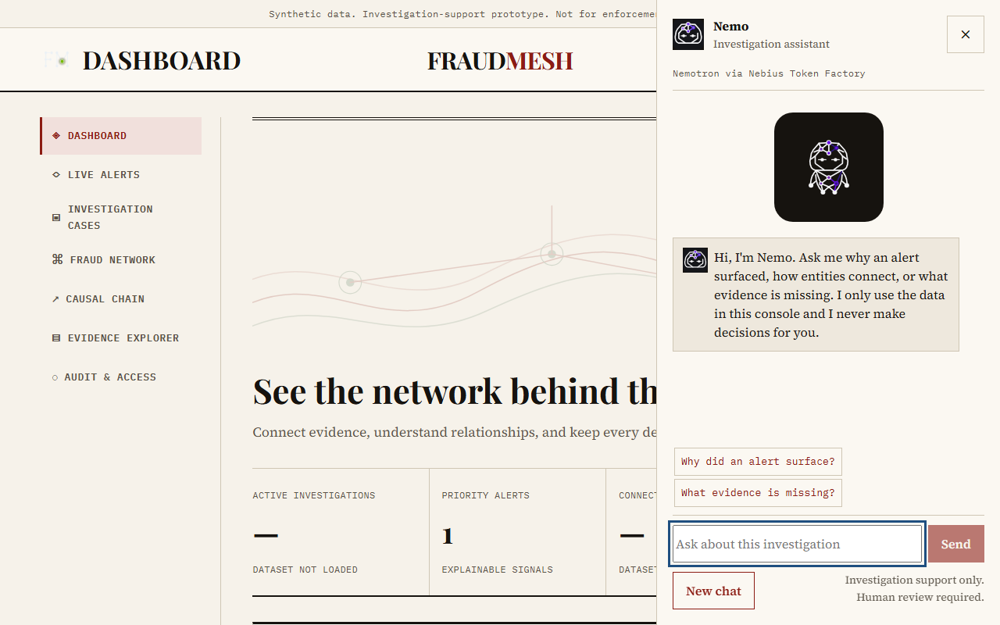

# FraudMesh

FraudMesh is an investigation-support console for reviewing synthetic fraud signals as a connected, evidence-cited network.

**Team:** Code Blooded · **License:** MIT · **Hackathon track:** NVIDIA × Nebius AI (confirm current wording before submission)

> Synthetic data only. Investigation support only. Human review required. FraudMesh does not determine guilt or take automatic enforcement action.

Fresh per-tab captures with the Nemo drawer open (light and dark): [Dashboard](docs/media/nemo/dashboard-light.png) / [dark](docs/media/nemo/dashboard-dark.png) · [Live Alerts](docs/media/nemo/live-alerts-light.png) / [dark](docs/media/nemo/live-alerts-dark.png) · [Investigation Cases](docs/media/nemo/investigation-cases-light.png) / [dark](docs/media/nemo/investigation-cases-dark.png) · [Fraud Network](docs/media/nemo/fraud-network-light.png) / [dark](docs/media/nemo/fraud-network-dark.png) · [Causal Chain](docs/media/nemo/causal-chain-light.png) / [dark](docs/media/nemo/causal-chain-dark.png) · [Evidence Explorer](docs/media/nemo/evidence-explorer-light.png) / [dark](docs/media/nemo/evidence-explorer-dark.png) · [Audit & Access](docs/media/nemo/audit-access-light.png) / [dark](docs/media/nemo/audit-access-dark.png).

Live frontend: **TODO: Render URL** · Nebius backend: **TODO: backend URL** · Demo video: **TODO: demo video URL** · Repository: https://github.com/speed-velocity/FRAUDMESH

## Problem and approach

FraudMesh helps investigators move from a suspicious signal to a reviewable explanation without losing chronology, provenance, or uncertainty. It loads a canonical synthetic event set, applies deterministic rules, exposes the evidence graph, and keeps actions auditable. Optional Nemotron drafts use server-owned masked context. The design principle is: **model fills data, code decides; every claim cites evidence IDs; humans make every decision; synthetic data only.**

## Features

Dashboard provides risk summaries, event simulation, evaluation readiness, queue, and safeguards. Live Alerts provides deterministic R1–R6 signals, filters, evidence, and Acknowledge/Escalate/Dismiss actions. Investigation Cases provides case lifecycle, notes, chronology, contradictions, findings, hypotheses, plans, and case briefs. Fraud Network provides search, clusters, links, paths, Ask the graph, and cluster stories. Causal Chain provides bounded source-to-target paths. Evidence Explorer provides masked records and audited reason-gated unmasking. Audit & Access provides append-only history, users, controls, and admin-only live metrics. Nemo, complaint intake, devil's advocate, Council of 3, and scam classification are optional Nemotron features with deterministic fallbacks.

### Feature guide: what each feature does and why it is needed

| Feature | What it does | Why it is needed |
|---|---|---|
| Dashboard | Summarises risk, alerts, entities, evidence, evaluation, and simulator state. | Gives an investigator one starting point and makes system coverage visible. |
| Live Alerts | Shows deterministic signals, reasons, rules, evidence, and review actions. | Turns raw events into prioritised, explainable review work. |
| Investigation Cases | Groups an alert with notes, chronology, contradictions, findings, hypotheses, and plans. | Preserves the reasoning trail across a longer investigation. |
| Case brief | Generates a cited summary, timeline, gaps, contradictions, and next checks. | Reduces review time while keeping evidence and human review central. |
| Fraud Network | Maps accounts, people, devices, links, clusters, and bounded paths. | Reveals relationships that are difficult to see in a flat alert list. |
| Ask the graph | Converts a natural-language question into a validated graph query. | Lets investigators explore safely without allowing model-written queries or SQL. |
| Causal Chain | Tests whether a bounded ordered path exists between two entities. | Separates established paths from unsupported assumptions. |
| Evidence Explorer | Searches masked records and controls audited unmask requests. | Keeps source material inspectable while protecting sensitive identifiers. |
| Audit & Access | Shows actor, action, target, outcome, users, controls, and model telemetry. | Makes protected actions and live-model usage accountable. |
| Event simulator | Replays held-out synthetic events and records outcomes. | Demonstrates deterministic behaviour without changing production records. |
| Evaluation readiness | Reports synthetic DEV/HELD-OUT coverage and error counts. | Measures rule coverage honestly without presenting it as a production metric. |
| Nemo assistant | Answers grounded questions using server-retrieved masked context. | Gives investigators a conversational entry point without granting action authority. |
| Cluster story | Summarises graph hubs, links, uncertainties, and next checks. | Helps review a connected group without treating inferred links as facts. |
| Complaint intake | Extracts structured details from English, Hinglish, or Devanagari complaints. | Makes narrative complaints comparable with authoritative ledger records. |
| Devil's advocate | Presents plausible benign hypotheses and checks. | Reduces confirmation bias before a human determination. |
| Council of 3 | Runs Analyst, Skeptic, and Auditor review seats in parallel. | Provides structured disagreement without changing scores or actions. |
| Scam classifier | Classifies synthetic scam-script patterns and verifies quoted red flags. | Speeds triage while constraining outputs to a closed, reviewable taxonomy. |

## Architecture

~~~mermaid
flowchart LR
  Browser[React/Vite browser UI] --> API[FastAPI backend]
  API --> Rules[Deterministic rules and risk engine]
  API --> Graph[Graph and path services]
  API --> Evidence[SQLite evidence and case store]
  API --> TF[Nebius Token Factory]
  TF --> Model[NVIDIA Nemotron]
  Nebius[Nebius AI Cloud hosting target] --> API
~~~

The browser calls FastAPI. The backend owns authentication, IDs, rules, masking, persistence, output validation, and audit logging. Only bounded masked context is sent to Token Factory. Model output cannot execute a query, change an alert action, release evidence, or determine guilt. All included records are synthetic.

## Built with NVIDIA Nemotron + Nebius

Configured model: nvidia/Nemotron-3_5-Lightning, from NEMOTRON_MODEL in .env.example and render.yaml. **TODO:** confirm account access and current open-source license/eligibility using official Token Factory, model, and hackathon documentation.

The shared client is backend/app/reasoning/client.py. It calls the OpenAI-compatible NEMOTRON_BASE_URL plus /chat/completions, uses backend-only NEMOTRON_API_KEY, and sends NEMOTRON_MODEL. Calls are single-response HTTP calls; Council of 3 makes three parallel application calls; streaming is not implemented. Use scripts/bench_token_factory.py with a private key to measure latency; no unmeasured benchmark is claimed.

| Feature | Route | Code path | Validation |
|---|---|---|---|
| Live explanation | /api/v1/alerts/{entity_id}/reasoning | main.explain_alert -> reasoning.live | JSON/plaintext parsing and evidence-ID validation |
| Case reasoning/brief | /api/v1/cases/{case_id}/reasoning, /brief | main -> reasoning.live/brief | Grounded schemas and cited-ID validation |
| Nemo | /api/chat | main.nemo_chat -> reasoning.nemo | Citation checks and safety refusals |
| Graph/cluster/council | /api/network/ask, /api/network/clusters/.../story, /api/alerts/.../council | reasoning.features3/advanced | Whitelists, filtered citations, server consensus |
| Complaint/scam/devil | /api/complaints/intake, /api/scam/classify, /api/alerts/.../devils-advocate | reasoning.advanced/features3 | Closed schemas and verified quotes |

Token Factory configuration and generic Nebius AI Cloud container guidance are in docs/NEBIUS_DEPLOY.md. The exact account-specific Nebius hosting service is TODO. Admins can verify calls at Audit & Access -> Nemotron performance; owners can use scripts/smoke_live.sh and scripts/smoke_nemo.sh. Metrics never contain prompts, completions, evidence, or user messages.

## Quick start

Prerequisites: Git, Python 3.11+, Node.js 18+, npm, and optionally Docker.

macOS/Linux:

~~~bash
git clone https://github.com/speed-velocity/FRAUDMESH.git
cd FRAUDMESH
python3 -m venv .venv && . .venv/bin/activate
python -m pip install -r backend/requirements.txt
npm --prefix frontend install
cp .env.example backend/.env
uvicorn app.main:app --app-dir backend --host 127.0.0.1 --port 8000
# another terminal:
npm --prefix frontend run dev -- --host 127.0.0.1 --port 5174
~~~

Windows PowerShell:

~~~powershell
git clone https://github.com/speed-velocity/FRAUDMESH.git
cd FRAUDMESH
python -m venv .venv
.\\.venv\\Scripts\\Activate.ps1
python -m pip install -r backend/requirements.txt
npm --prefix frontend install
Copy-Item .env.example backend/.env
python -m uvicorn app.main:app --app-dir backend --host 127.0.0.1 --port 8000
# another terminal:
npm --prefix frontend run dev -- --host 127.0.0.1 --port 5174
~~~

Open http://127.0.0.1:5174/?protected=1#dashboard; health is http://127.0.0.1:8000/api/v1/health. The frontend shows a waking state while a sleeping free-tier backend starts. Run python -m pytest backend/tests, npm --prefix frontend run test, npm --prefix frontend run build, and npm --prefix frontend run ui:audit.

## Configuration and demo credentials

.env.example is the source of truth and contains no real secret. Variables are APP_ENV, DATABASE_URL, DATA_DIR, JWT_SECRET, TOKEN_KEY_ID, TOKEN_ISSUER, TOKEN_AUDIENCE, SESSION_MINUTES, LOGIN_RATE_LIMIT_PER_MINUTE, EXPENSIVE_RATE_LIMIT_PER_MINUTE, MAX_REQUEST_BODY_BYTES, LOGIN_MAX_ATTEMPTS, LOCKOUT_MIN, DEMO_INVESTIGATOR_USER, DEMO_INVESTIGATOR_PASSWORD, DEMO_ADMIN_USER, DEMO_ADMIN_PASSWORD, NEMOTRON_BASE_URL, NEMOTRON_API_KEY, NEMOTRON_MODEL, NEMOTRON_TIMEOUT_S, NEMOTRON_MAX_TOKENS, NEMOTRON_TEMPERATURE, NEMOTRON_MAX_JOBS_PER_MIN, REASONING_MODE, REASONING_MAX_PARALLEL, MAX_CONTEXT_TOKENS, MAX_NARRATIVE_CHARS, INGEST_STRICT, MAX_FILE_MB, CORS_ORIGINS, LOG_LEVEL, SIM_INTERVAL_S, AUTO_QUEUE_REASONING, and VITE_API_ORIGIN. See .env.example for purposes and placeholders. scripts/check_env_sync.py checks names.

The repository does not contain passwords. Startup creates users only when DEMO_INVESTIGATOR_PASSWORD and DEMO_ADMIN_PASSWORD are supplied. Usernames are investigator and admin; set private demo passwords locally. They are demo-only and must not be reused. Admins additionally access Audit & Access and metrics.

## Three-minute judge walkthrough

1. Sign in as investigator -> Live Alerts -> ACC-M3.
2. Review evidence, Explain with Nemotron, Challenge this signal, and Convene council.
3. Choose Open investigation case, then Investigation Cases -> Generate case brief.
4. Fraud Network -> inspect clusters -> Ask the graph.
5. Evidence Explorer -> inspect masked records and audited unmask flow.
6. Sign in as admin -> Audit & Access -> Nemotron performance.
7. In Nemo try: “Why did ACC-M3 surface?”, “What contradictions exist in this case?”, “Is ACC-M3 guilty?” (refusal), and “Unmask E-0093” (refusal).

## Evaluation

See docs/EVALUATION.md. held_out=false is DEV and held_out=true is HELD-OUT; the held-out stream is not used to tune rules. Run python scripts/eval.py for current JSON. **TODO:** record the output and date for submission. These are synthetic evaluation signals, not production metrics.

## Trust, safety, and troubleshooting

All records are synthetic. Server code owns identity, roles, scores, evidence IDs, masking, and action permissions. Reasoning prompts use bounded masked context; evidence and user text are untrusted. Citation validation strips unsupported IDs. Rate limits and request-size limits apply. Audit metadata does not store full prompts or messages. Human review is required and no automatic enforcement action is taken.

- Cold start: wait for the waking state and retry; free-tier services may sleep.
- API OFFLINE: check /api/v1/health, backend logs, CORS_ORIGINS, and VITE_API_ORIGIN.
- Nemotron unavailable: check NEMOTRON_BASE_URL, NEMOTRON_API_KEY, and NEMOTRON_MODEL on the backend only.
- 401: set both demo passwords and restart.
- Port conflict: change local FastAPI/Vite ports and matching origins.

## Project structure and testing

~~~text
backend/app/       FastAPI routes, auth, database, reasoning, metrics
backend/tests/     Backend unit/security/feature tests
data/demo/         Synthetic records and held-out stream
data/ground_truth/ Synthetic evaluation labels
config/            Rule, scoring, thresholds, language guard
frontend/src/      React app, tokens, routes, components, styles
frontend/tests/    Playwright UI audit
scripts/           Smoke, benchmark, evaluation, environment checks
docs/              Deployment, evaluation, acceptance, submission docs
artifacts/         Screenshot evidence
~~~

## Deployment, roadmap, and acknowledgements

render.yaml defines the current Render frontend/backend blueprint. Nebius hosting details remain account-specific; see docs/NEBIUS_DEPLOY.md. Not shipped: verified public URLs, demo video, and additional production hardening. Team member names/links: **TODO (owner to fill)**.

Built with NVIDIA Nemotron and Nebius Token Factory. Nemo is FraudMesh's assistant name and is unrelated to NVIDIA NeMo. See THIRD_PARTY_NOTICES.md.

## License

MIT. Copyright (c) 2026 Code Blooded. See LICENSE.
